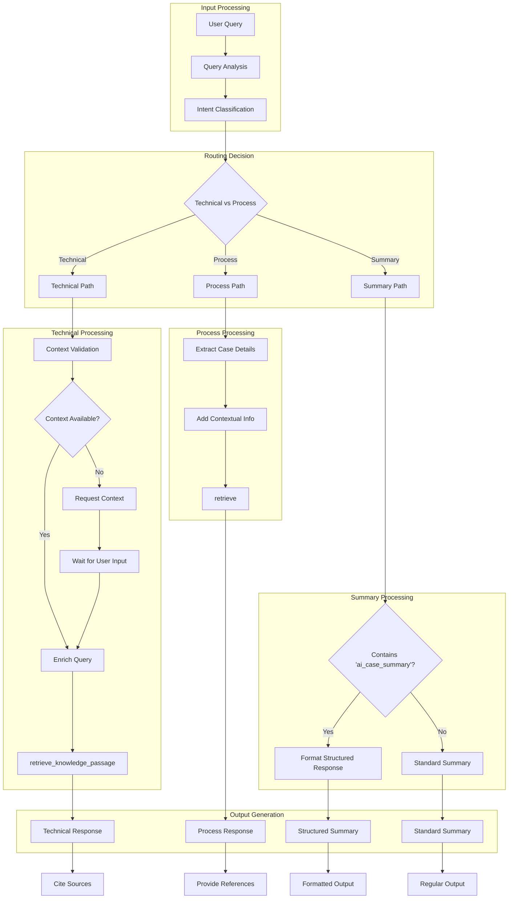
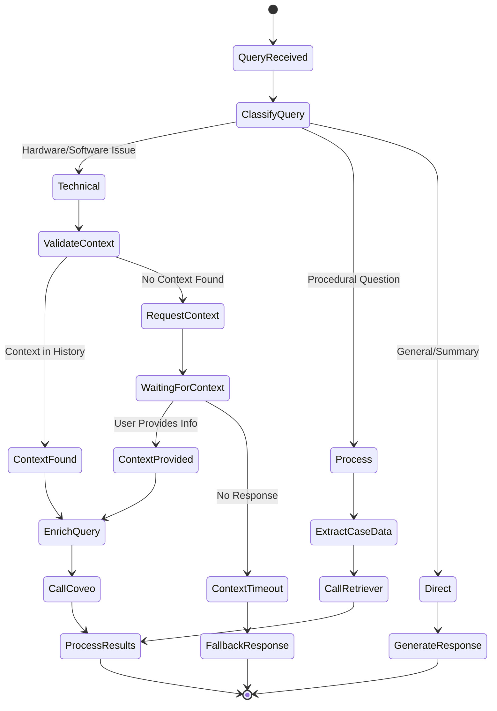
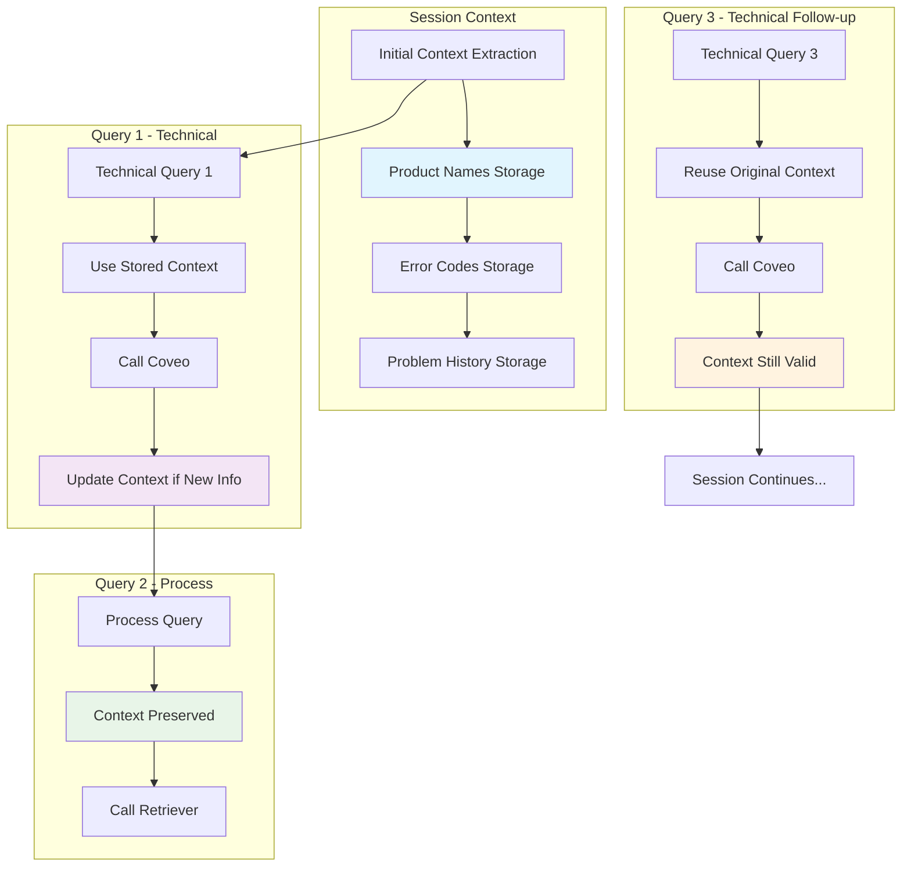
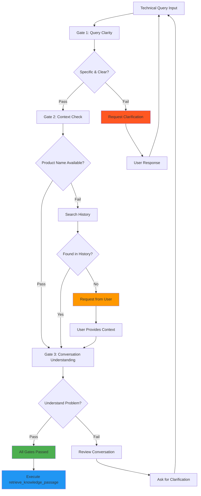
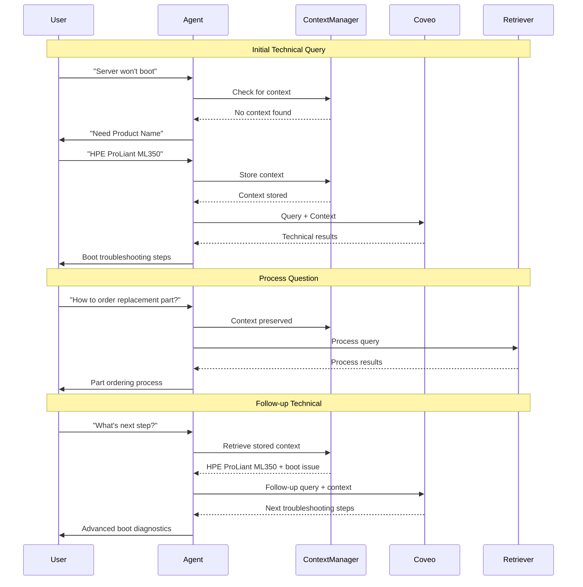
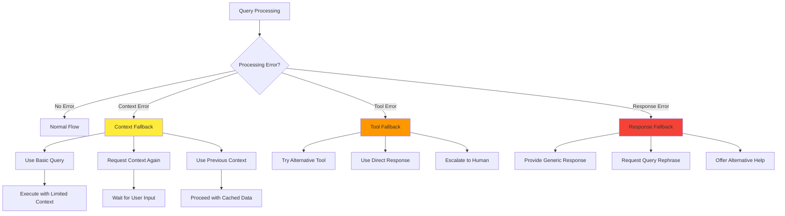
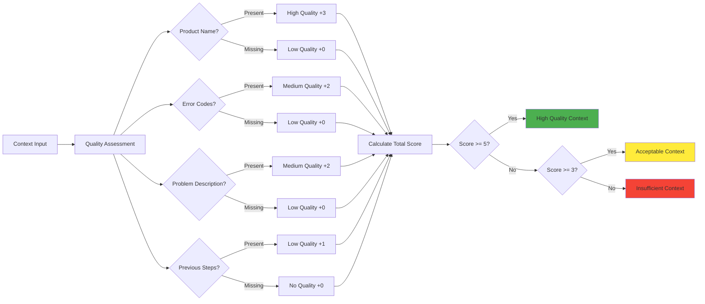
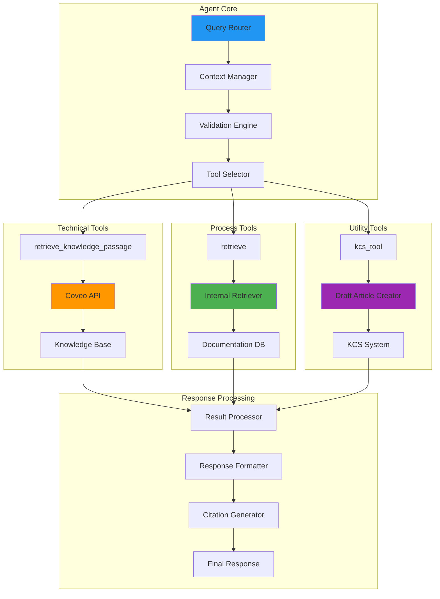

# Query Enrichment Implementation Diagrams

## Advanced Workflow Diagrams

### 1. Complete Query Processing Pipeline



### 2. Context Enrichment State Machine



### 3. Context Inheritance Pattern



### 4. Validation Gate System



### 5. Multi-Turn Conversation Flow



### 6. Error Handling and Fallbacks



### 7. Context Quality Assessment



### 8. Tool Integration Architecture



## Implementation Guide

### Context Structure Implementation

```typescript
interface QueryContext {
  productNames: string[];
  errorCodes: string[];
  problemDescription: string;
  stepsAttempted: string[];
  timestamp: Date;
  quality: ContextQuality;
}

interface ContextQuality {
  score: number;
  hasProductName: boolean;
  hasErrorDetails: boolean;
  hasProblemDescription: boolean;
  level: 'high' | 'medium' | 'low' | 'insufficient';
}
```

### Validation Rules Implementation

```python
def validate_technical_query(query, context, conversation_history):
    """
    Implement three-gate validation system
    """
    # Gate 1: Query Clarity
    if not is_specific_and_clear(query, conversation_history):
        return ValidationResult.NEEDS_CLARIFICATION
    
    # Gate 2: Context Check
    if not has_sufficient_context(context, conversation_history):
        return ValidationResult.NEEDS_CONTEXT
    
    # Gate 3: Conversation Understanding
    if not understands_problem_context(query, conversation_history):
        return ValidationResult.NEEDS_REVIEW
    
    return ValidationResult.PASSED
```

This comprehensive implementation guide provides the technical foundation for implementing the query enrichment system with proper error handling, context management, and validation processes.
